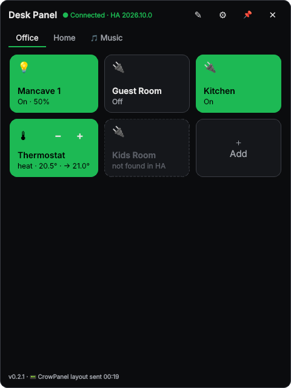
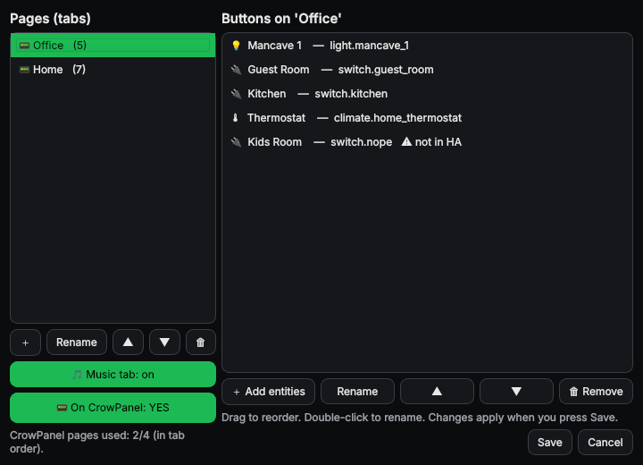
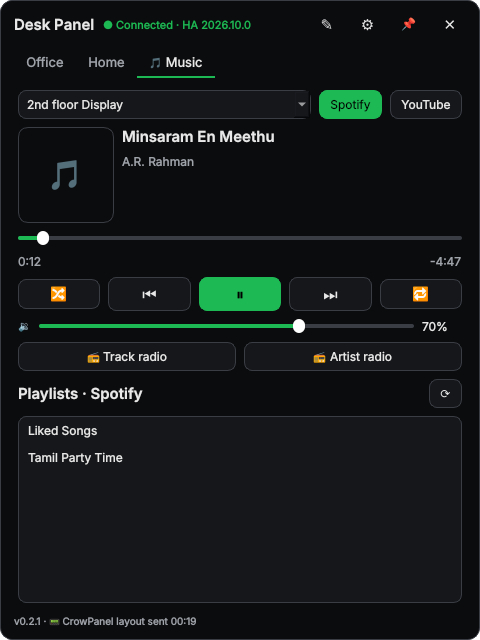

# CrowPanel HA Desk Panel

A Home Assistant desk touch panel for the **Elecrow CrowPanel 7" Basic (ESP32-S3, V3.0)**, built with
ESPHome + LVGL, plus an optional **Windows tray app** that edits the panel's buttons live. You never have to
reflash to change a button.

- **Home screen:** clock + date, temperature, now-playing strip, up to 8 favourite buttons and
  shortcuts to every page. Idle pages (except Music) return home after a timeout you set in the
  desktop app; sleeping also returns home.
- **4 button pages** (4×3 = 12 buttons each) for lights, switches, scenes, scripts, fans and covers.
  Green = on, black = off, dimmed = unavailable. Buttons always match HA: they repaint on boot, on
  reconnect, on wake, every 5 s and right after a tap.
- **Music** via Music Assistant: speaker dropdown, Spotify / YouTube Music switch, album art,
  progress bar + seek, shuffle / repeat, volume, "track radio" / "artist radio".
- **Library:** browse your Music Assistant playlists and tap one to play.
- **Speakers:** group / ungroup speakers and set each one's volume.
- **Climate:** thermostat page (− / + setpoint).
- **Screen sleep** after 10 min (adjustable from HA). Touch to wake.
- **Windows tray app:** the same buttons on your PC, an entity picker, drag-to-reorder, and a
  "📟 On CrowPanel" toggle that sends a page to the panel through HA.

| Desktop app | Layout editor | Music |
|---|---|---|
|  |  |  |

## How it fits together

```
 Windows tray app ──(HA WebSocket: event desk_panel_layout_set)──► Home Assistant
                                                                    │  package desk_panel.yaml
                                                                    │  • sensor.desk_panel_layout  (pages → compact strings)
                                                                    │  • sensor.desk_panel_now_playing / _playlists
                                                                    │  • script.desk_panel_tap / play_pause / radio …
                                                                    ▼
                                                  CrowPanel (ESPHome native API)
```

The panel only *reads* HA sensors and *calls* HA scripts, so you can use the panel without the
desktop app. In that case you set the layout by firing the event yourself (see
[Without the desktop app](#without-the-desktop-app)).

## Repository layout

| Folder | What | Version |
|---|---|---|
| [`firmware/`](firmware) | ESPHome YAML + 2 small C++ headers for the CrowPanel | 3.2.0 |
| [`home-assistant/`](home-assistant) | HA package (`desk_panel.yaml`) | 3.1.0 |
| [`desktop-app/`](desktop-app) | Windows tray app (Python / PySide6) | 0.3.0 |
| [`enclosure/`](enclosure) | 3D-printable housing + 20° desk stand with a top-right volume knob | 1.0.0 |

## Hardware

- Elecrow CrowPanel 7.0" **Basic** HMI display, ESP32-S3 N4R8, 800×480, GT911 touch, **board V3.0**.
  Other board revisions should work, but the touch fixes below are specific to V3.0.
- USB-C cable and 5 V / 2 A power. No battery is needed.
- A case: print the one in [`enclosure/`](enclosure) (housing + desk stand + knob, no supports).
- Optional: an EC11 rotary encoder (KY-040 module) on the HY2.0 header as a volume knob. There's a
  commented-out stub at the bottom of the firmware.

## Setup

### 1. Home Assistant

1. **Music Assistant** should be installed and set up with your speakers. The music pages need it;
   the button pages don't.
2. Enable packages in `configuration.yaml` if you haven't already:
   ```yaml
   homeassistant:
     packages: !include_dir_named packages
   ```
   This goes at the **top level** of the file. Don't indent it under another integration.
3. Copy [`home-assistant/desk_panel.yaml`](home-assistant/desk_panel.yaml) to `/config/packages/desk_panel.yaml`
   and edit the two **CHANGE THESE** spots:
   - `input_select.desk_panel_player`: your 4 speaker entities.
   - `ha_url`: your HA's **local IP** URL (e.g. `http://192.168.1.10:8123`). The panel fetches album
     art from it.
4. **Developer tools → YAML → Check configuration**, then **restart** HA. A full restart is needed the
   first time. After later edits, reloading *Template entities* and *Scripts* is enough.

### 2. Firmware

1. In the ESPHome dashboard, create a device called `crowpanel-desk`, then replace its YAML with
   [`firmware/crowpanel-desk.yaml`](firmware/crowpanel-desk.yaml).
2. Copy `usb_disable.h` and `desk_layout.h` into the same folder (`/config/esphome/`).
3. Add the secrets the YAML uses to your ESPHome `secrets.yaml`. See
   [`firmware/secrets.example.yaml`](firmware/secrets.example.yaml).
4. Edit `substitutions:` at the top: `speaker_1` … `speaker_4` (same entities and order as the HA
   package) and `thermostat`.
5. Flash it the first time over USB. After that, OTA works.
6. In HA, go to **Settings → Devices & services → ESPHome → (panel) → Configure** and tick **"Allow the
   device to perform Home Assistant actions"**. Without this, taps do nothing.

### 3. Desktop app (optional, Windows)

See [`desktop-app/README.md`](desktop-app/README.md). In short:
1. Install Python 3.11+.
2. Run `build.bat` (or `run.bat`).
3. Enter your HA URL and a long-lived token.
4. Add buttons.
5. In **✎ Edit layout**, set "📟 On CrowPanel: YES" for up to 4 pages and press **Save**.

## Without the desktop app

Fire this event from **Developer tools → Events** (or from an automation):

```yaml
event_type: desk_panel_layout_set
event_data:
  pages:
    - name: Office
      tiles:
        - { entity_id: light.desk_lamp, label: Desk lamp }
        - { entity_id: switch.monitor, label: Monitor }
    - name: Home
      tiles:
        - { entity_id: light.hallway, label: Hall }
```

The layout is kept in `sensor.desk_panel_layout_store` and survives HA restarts.

## Troubleshooting (CrowPanel 7" V3.0)

| Symptom | Fix |
|---|---|
| Touch: `I2C software timeout`, "Communication failed", or no I2C devices on GPIO19/20 | Already handled in the YAML (`usb_disable.h`, `logger: hardware_uart: UART0`, GPIO19/20 reset at boot, PCA9557 touch-reset sequence). If it still fails, **re-seat the touch ribbon cable**. A loose one gives exactly these errors. |
| Wi-Fi won't start, `ESP_ERR_NO_MEM` | Keep the PSRAM `sdkconfig_options` in the YAML; they move Wi-Fi/LWIP buffers to PSRAM. |
| Buttons show state but tapping does nothing | Enable "Allow the device to perform Home Assistant actions" (step 2.6). |
| Pages stay blank / desktop app changes don't show | HA package not loaded: `sensor.desk_panel_layout` must exist. Restart HA after installing it, then press **Save** in the app. |
| Album art missing, HTTP 400 in logs | Set `ha_url` in the package to HA's local IP (not `homeassistant.local`, not Nabu Casa). |
| Dark-grey areas flicker | The theme is pure black on purpose. Avoid dark-grey fills with the RGB panel at 15 MHz. |
| Panel falls back to the previous firmware after an OTA | ESPHome safe mode. Reflash over USB. |

Tested with ESPHome 2026.9.1 (ESP-IDF, LVGL 9) and a current Home Assistant (2026.9+) with Music Assistant.

## License

[MIT](LICENSE). Contributions and issues welcome.
