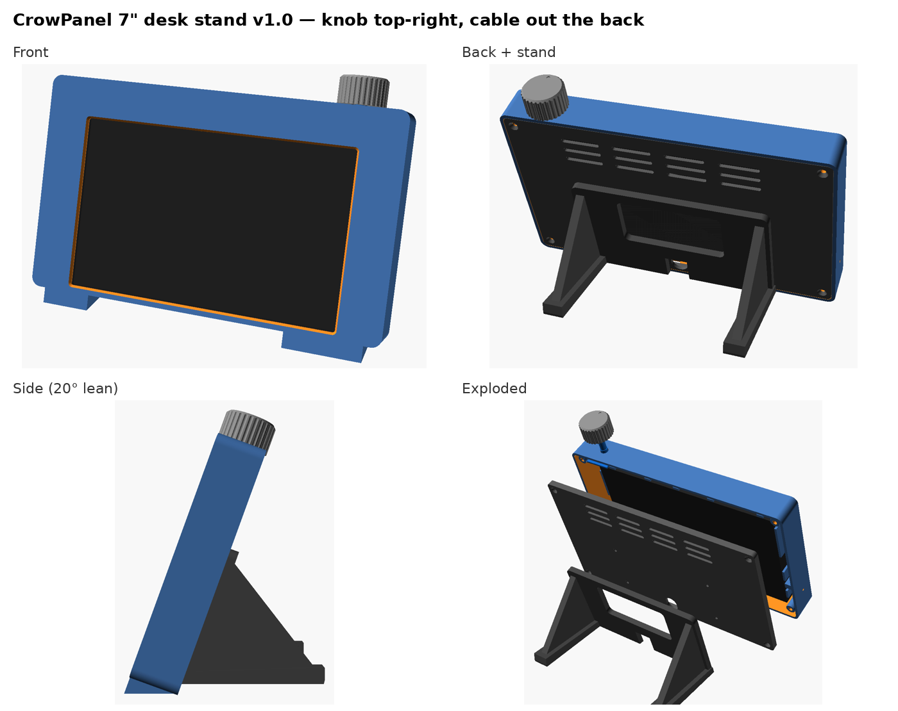

# CrowPanel 7" desk stand: v1.0.0

A 3D-printable housing and desk stand for the **Elecrow CrowPanel 7.0" Basic (board V3.0)**:

- **Volume knob top-right:** a KY-040 / EC11 encoder mounts through the top wall.
- **Fixed 20° lean.** Two legs at the back, plus wedge feet at the front so the stand can't tip forward.
- **Cable out the back:** a right-angle USB-C runs behind the panel and exits at the bottom centre, between the legs.
- **Pinholes** for the reset and boot buttons, and a slot for the TF card.
- No supports needed for any part.

Sizes come from Elecrow's official STEP model (`3D_File_CrowPanel_7.0-ESP32_HMI-3.0.stp`). The fit was
checked against that model: nothing touches except the back pads, which press the PCB with 0.2 mm preload.

## Print (Bambu P2S / any 256 mm bed)

| Plate | File | Orientation | Notes |
|---|---|---|---|
| 1 | `plate1_shell` | front face down (as exported) | ~141 × 220 mm. A textured PEI plate gives a nice front finish. |
| 2 | `plate2_back_cover_knob` | as exported | back cover (outside face down) + knob (top down) |
| 3 | `plate3_stand` | as exported (mounting face down) | 73 mm tall legs |

Suggested settings: PLA or PETG, 0.2 mm layers, 3 walls, 15 % gyroid, **no supports**. That's about 120 g in total.
Use the 3MF files in Bambu Studio. STLs are in `stl/` for other slicers.

## Hardware

| Qty | Part |
|---|---|
| 8 | M3 heat-set inserts (fits a 4.0 mm hole, 4–5.7 mm long) |
| 4 | M3 × 8 countersunk screws (back cover → shell) |
| 4 | M3 × 8 pan or button head screws (stand → back cover, from the inside) |
| 1 | KY-040 rotary encoder module, plus the nut and washer that come with it |
| 1 | **Right-angle USB-C cable** (an "up/down" or "left/right" L plug both fit) |
| 4–6 | Optional 8–10 mm silicone bumpon feet (recesses are in the legs and front feet) |

## Assembly

1. **Inserts:** press 4 into the shell bosses and 4 into the stand (from the flat mounting face).
2. **Stand → back cover:** M3 × 8 pan heads go from the *inside* of the back cover into the stand.
3. **Knob module:** push the encoder bushing up through the hole in the top wall, from inside. Fit the
   washer and nut on top, then press the knob on. Wire it to the panel's top-edge HY2.0 ports
   (CLK → IO44, DT → IO43, + → 3V3, GND on the UART port; optional SW → IO38 on GPIO_D). Turning works with
   firmware 3.1+; for the press, enable the commented section at the bottom of the firmware YAML.
4. **USB:** plug the right-angle USB-C into the panel's left edge. Lay the cable **behind the panel**
   along the bottom and out the slot at the bottom centre of the back cover.
   If your plug points straight back, punch out the thin knock-out behind the USB port instead.
5. **Panel:** drop it face-down into the shell, so the screen sits against the bezel.
6. **Close:** put the back cover on and fit the 4 countersunk screws. Don't over-tighten; the pads clamp the panel.

## Customise

Open `crowpanel_desk_stand.scad` in OpenSCAD (or MakerWorld's Parametric Model Maker). The main settings:
`tilt`, `leg_reach`, `knob_x`, `knob_d`, `shaft` (knurled or D), `clr` (panel clearance), `insert_d`.
Render with `part = "shell" | "back" | "stand" | "knob"`. Use `assembly` or `exploded` to preview.

License: MIT
